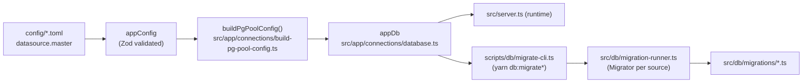

# Kysely and Migrations

PostgreSQL access goes through [Kysely](https://kysely.dev) (typed SQL query builder) over one
`pg.Pool` per datasource. There are no models, no global registry and no associations: rows are plain
objects. Migrations run through Kysely's `Migrator`, wrapped by a small project CLI.



The runtime and the migration CLI share `appDb`, so both connect with the same settings.

## Connection

- `await appDb.initialize('master')` creates the pool and runs `select 1` (pg connects lazily, so this
  proves the connection at boot). On failure the pool is destroyed and the error rethrown.
- `appDb.getDb<DB>()` returns `Kysely<DB>`; it throws if `initialize()` was not called. Pass the table
  interface the caller may touch; a module passes only its own tables. Never use `Kysely<any>` outside
  migrations.
- `appDb.disconnectAll()` destroys every pool (graceful shutdown).
- SQL is logged at `debug` (`LOG_LEVEL=debug`). Query parameters are never logged.

TOML → `pg.PoolConfig` mapping (`buildPgPoolConfig`):

| TOML (`datasource.master`) | pg | Note |
|---|---|---|
| `host`, `port`, `database`, `password` | same | |
| `username` | `user` | |
| `pool.max` / `pool.min` | `max` / `min` | |
| `pool.idle` | `idleTimeoutMillis` | |
| `pool.acquireTimeout` | `connectionTimeoutMillis` | pg has one timeout for getting a client, incl. connecting |
| `option.ssl` | `ssl` | |
| `schema` | `options: -c search_path=<schema>` | only when not `public`; must be a lowercase identifier |
| `dialect` | — | only `postgres` is accepted |

## Commands

| Command | What it does |
|---|---|
| `yarn db:migrate` | Apply all pending migrations of every source |
| `yarn db:migrate:undo [--source <name>]` | Undo the last migration of one source (default `platform`) |
| `yarn db:migrate:status` | List each migration as executed (with time) or pending |
| `yarn db:migration:create <table> -c "<cols>"` | Scaffold a create-table migration from the template |

Like the app, the CLI loads `.env` (through `yarn script`) and the layered TOML config; select the
environment with `NODE_ENV`. Exit code is `1` when a migration fails.

## Migration Sources

A source is a folder plus its own tracking tables `<name>_migration` and `<name>_migration_lock`
(`MigrationSource` in `src/db/migration-runner.ts`). Today only `platform` exists
(`src/db/migrations/`). A module can later own `src/modules/<m>/migrations/` with its own tables;
order across sources does not matter because cross-module foreign keys are banned. Add new sources to
`MIGRATION_SOURCES`.

Migrations are loaded with `require()` (`RequireMigrationProvider`), not Kysely's
`FileMigrationProvider`: its native `import()` bypasses ts-node + tsconfig-paths, so `src/*` imports
inside migrations would fail. Consequence: run migrations from source through `yarn script` (the
`db:*` scripts do), or from `dist/` after `yarn build`.

## Migration File Format

```ts
import type { Kysely } from 'kysely';
import * as MigrationUtils from 'src/db/migration-blueprint';

export async function up(db: Kysely<any>): Promise<void> {
  await MigrationUtils.addColumns(db.schema.createTable('products'), {
    id: MigrationUtils.primaryKey(),
    name: MigrationUtils.genericString(true),
    ...MigrationUtils.softDeleteColumns,
    ...MigrationUtils.timestampColumns,
  }).execute();
}

export async function down(db: Kysely<any>): Promise<void> {
  await db.schema.dropTable('products').execute();
}
```

The migration name is the file name without extension. On PostgreSQL, Kysely runs pending migrations in
one transaction.

## Blueprint Helpers (`src/db/migration-blueprint.ts`)

| Helper | PostgreSQL |
|---|---|
| `primaryKey()` | `uuid not null primary key default gen_random_uuid()` |
| `uuid(required, unique)` | `uuid` |
| `genericString(required, length = 255, default?)` | `varchar(length)` |
| `text(required)` | `text` |
| `integer(required, default?)` | `integer` |
| `unsignedInteger(required, default?)` | `integer` + `check (col >= 0)` |
| `bigInteger(required, default?: bigint)` | `bigint` |
| `decimal(required, p = 36, s = 18, default = 0)` | `numeric(p, s)` |
| `datetime(required, default?)` / `date(...)` | `timestamptz` / `date` |
| `enumType(values, required, default?)` | `varchar(64)` + `check (col in (...))` (no PG enum type) |
| `jsonType(required)` | `jsonb` |
| `foreignKey(refTable, refCol = 'id', required, type = 'uuid', onDelete?, onUpdate?)` | `references` (same module only) |
| `softDeleteColumns` | `deletedAt timestamptz null` |
| `timestampColumns` | `createdAt`, `updatedAt` `timestamptz not null default now()` |

SQL-function defaults are passed as `` sql`now()` ``. `updatedAt` has no trigger: set it on every update.

## History: Sequelize Baseline

`20260724075029-create-user.ts` was originally a Sequelize migration. It was ported in place, hand-written
and idempotent (`IF NOT EXISTS`, keeps the `enum_users_role` type name), so databases created by Sequelize
skip it and fresh databases get an identical schema. This is the only allowed edit of an applied
migration. A leftover `SequelizeMeta` table in an old local database is unused and can be dropped by hand.

## Troubleshooting

- **Lock left behind after a crash**: once sure no runner is active,
  `update platform_migration_lock set is_locked = 0;`
- **`Unable to connect`**: check `datasource.master` in `config/<env>.local.toml`; the CLI exits `1` and
  closes the pool.
